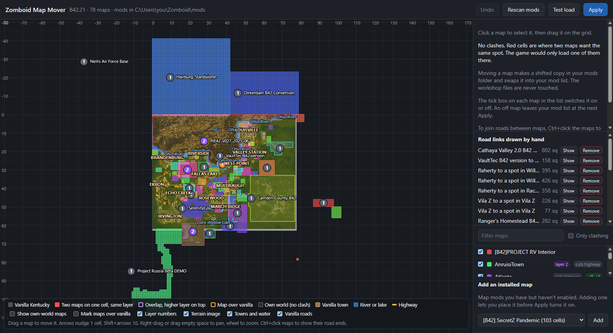
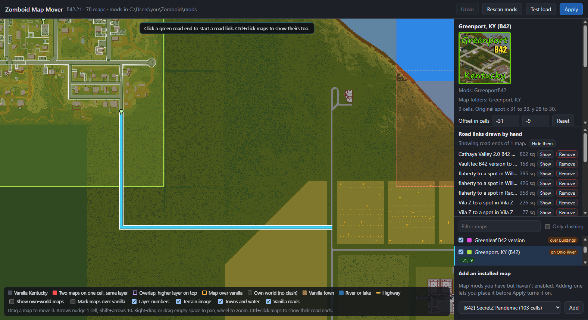
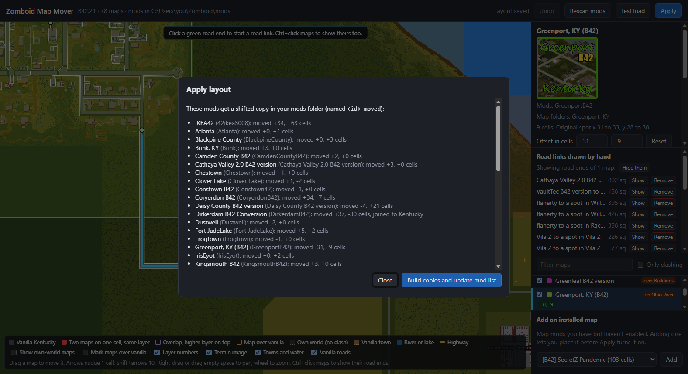
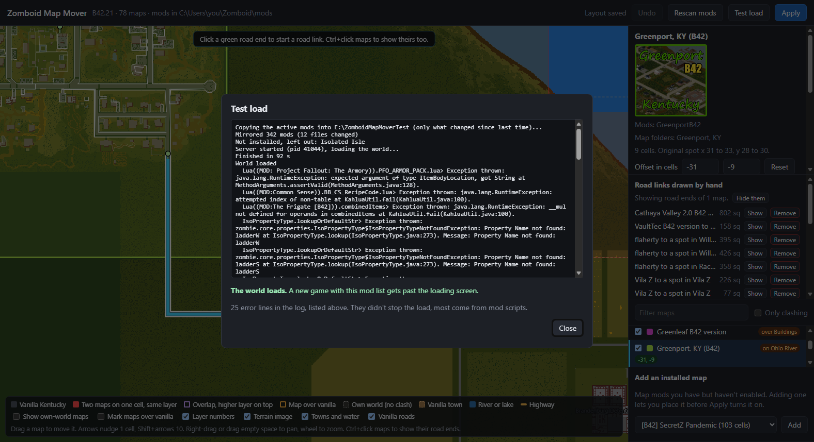
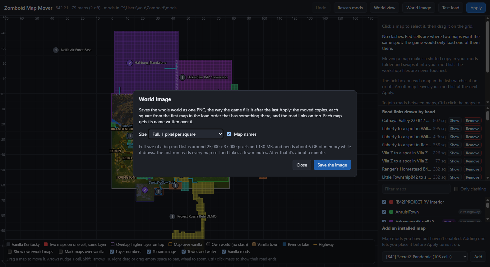
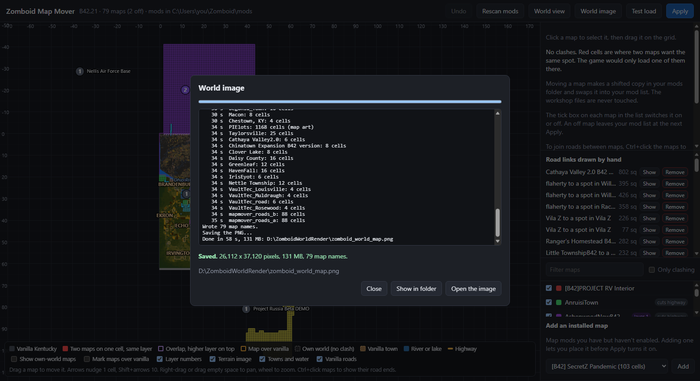
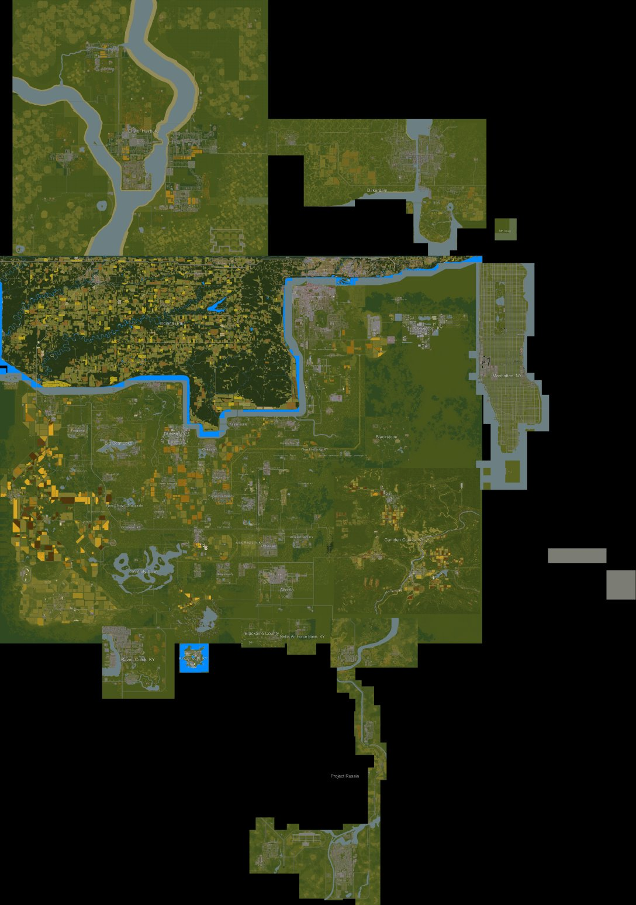
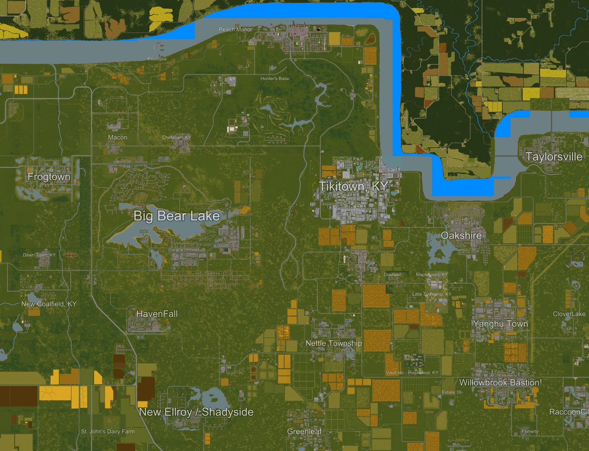

# Zomboid Map Mover

A desktop app for Project Zomboid build 42 map mods. It shows every map in
your mod list on one cell grid over vanilla Kentucky. You drag the maps that
fight over the same cells to free ground, press Apply, and it writes moved
copies of those mods and points your mod list at them.



## Why

Most Kentucky map mods are built for one spot on the world map, and many
popular ones picked the same empty cells. When two maps claim a cell, the
game loads only one of them, so half a town goes missing. Sometimes the new
world won't load at all. Moving a map means shifting every coordinate in its
files: the lot files, the world map data, the terrain image, `map.info`, and
the Lua that spawns things at fixed spots. Nobody wants to do that by hand
for thirty mods.

## What it does

- **Drag and drop on a cell grid.** Each map is drawn from its own terrain
  image, or from its lot files when it ships none. Red cells are two maps on
  the same ground. Arrows nudge a map one cell, Ctrl+Z undoes.
- **Layers.** Where maps should overlap, put one on a higher layer and it
  wins every square it has something on. Apply sorts the `maps { }` block
  to match.
- **The load crash check.** Build 42 crashes on a new world when the first
  map folder that covers a chunk doesn't have that cell. The app rebuilds
  the game's folder order, lists every spot where that happens, and says
  what fixes each one.
- **Road links.** Click a road end on one map and a road on another, and
  the app routes a road between them around buildings and over narrow water.
  Apply paves it into a small extra mod that loads on top.
- **Switch maps on and off.** Each map in the list has a tick box. An off map
  leaves your mod list at the next Apply and keeps its spot and its moved
  copy for when you tick it back on.
- **Test load.** Starts the game's dedicated server, hidden, and has it make
  a new world from your mod list. If it gets past the loading screen, so
  will a new game. It works from its own folder, so your saves and settings
  stay out of it.
- **Keeps your map order.** Pressing Accept in the game's mod screen throws
  the `maps { }` order away whenever no two maps share a cell, which is
  always true once maps are moved, and the game's own order can crash a new
  world. Apply adds a small mod, `mapmover_orderkeeper`, that puts the order
  back before the game saves or uses the list.
- **World image.** Saves the whole world as one PNG at a pixel per square,
  drawn the way the game fills it after the last Apply, with each map's name
  written over it. A big mod list comes out around 26,000 x 37,000 pixels.



The workshop folders are never written to. Moved copies go in your own
`Zomboid/mods` folder as `<id>_moved`, and every Apply backs up
`default.txt` first.





### The world image

The World image button saves every active map as one picture, so you can see
where everything ended up and where to drive. Moved copies sit where Apply
put them, each square comes from the first map in the load order that has
something there, and road links draw on top. Map names are small, thin and
see-through so they don't hide the towns under them.





The whole world, shrunk 24 times:



A piece of it at about a third of full size:



The first run reads every map cell and takes a few minutes. After that it's
about a minute. Full size needs around 6 GB of memory while it draws, so pick
Half or Quarter on a smaller machine. It also runs without the app:

```
python -m mapmover.worldpng out.png --scale 2
```

## Running it

You need Windows, Python 3 (built on 3.12), and Project Zomboid build 42
from Steam.

```
pip install -r requirements.txt
python -m mapmover.shortcut     # puts a desktop shortcut on your desktop
python -m mapmover.desktop      # or just open the app
```

The app is a local web page in its own window (pywebview on WebView2). Without
pywebview it opens in your browser instead. `run.bat` starts the console
version. The server only listens on 127.0.0.1. Pillow and numpy are only
needed for the World image. The rest of the app runs without them.

It finds Steam, the game and your Zomboid folder by itself. To override any
of them, put a `config.json` next to `run.bat`:

```json
{
  "game_dir": "D:/SteamLibrary/steamapps/common/ProjectZomboid",
  "workshop_dir": "D:/SteamLibrary/steamapps/workshop/content/108600",
  "mods_dir": "C:/Users/you/Zomboid/mods",
  "testload_dir": "D:/ZomboidMapMoverTest"
}
```

The test load keeps a mirror of your active mods in `testload_dir`. It
defaults to a folder at the top of the workshop's drive, because the mirror
uses hard links to the workshop files and those only work on one drive.

After moving anything, start a new save. An existing save keeps the cells it
already generated where they were.

## How it's built

Python standard library on the server, plain JavaScript and a canvas on the
page, no build step. The parts worth reading:

| File | What it does |
| --- | --- |
| `mapmover/scan.py` | Finds the mods and map folders the game would load |
| `mapmover/shifters.py`, `luashift.py`, `lots.py` | Shift the coordinates in each kind of map file |
| `mapmover/build.py` | Makes the moved copies and rewrites `default.txt` |
| `mapmover/loadorder.py` | The game's map folder order, and the crash check |
| `mapmover/roads.py`, `connect.py` | Road ends, routing and paving |
| `mapmover/testload.py` | The hidden dedicated server run |
| `mapmover/worldpng.py` | The world image and its map names |
| `web/app.js` | The page |

## Tests

```
python -m unittest discover -s tests
```

The order keeper's Lua tests need `pip install lupa` and are skipped without it.

`python -m tests.sweep_workshop` runs every shifter over every map you have
installed without writing anything, and lists what fails.

## Limits

- Road links pave plain street tiles on the ground floor. No curbs, lines or
  sidewalks, and the in-game world map doesn't show them.
- Lua that hardcodes coordinates outside the map's own files isn't shifted.
  Each moved copy has a build note listing what was skipped.
- When a workshop map updates, its moved copy catches up at the next Apply.

## License

MIT
